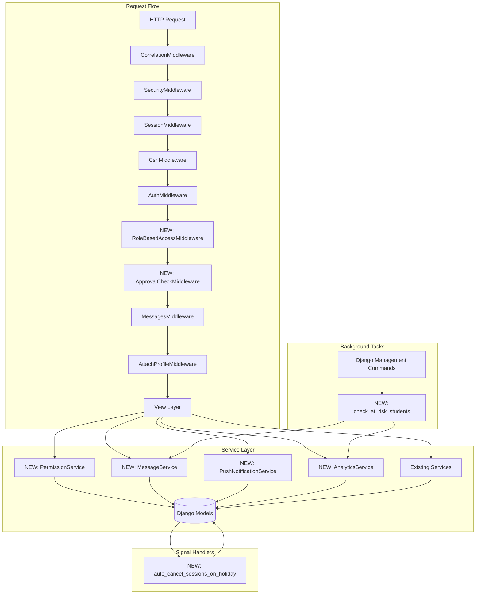

# Design Document: System Integration & Enhancement Suite

## Overview

The System Integration & Enhancement Suite enhances the KCC ClassStamp Django attendance system with 20 critical improvements across security hardening, workflow automation, role-based access control, and communication infrastructure. This design integrates seamlessly with the existing 5-tier Django architecture (Models → Forms → Services → Views → Templates) without introducing breaking changes.

### Design Philosophy

- **Defense in depth**: Security enforced at multiple layers (middleware + decorators + services)
- **Non-breaking integration**: New components extend existing patterns without disrupting current functionality
- **Service layer centralization**: Business logic lives in services, not views or middleware
- **Audit trail completeness**: All privilege operations logged in AuditEvent

### Existing Architecture Context

**Current Stack:**
- **Models**: 15+ models across academic.py, profile.py, classroom.py, attendance.py, audit.py, excuse.py, notifications.py
- **Services**: 25+ service modules in apps/core/services/
- **Middleware Pipeline**: 
  1. RequestCorrelationIdMiddleware
  2. SecurityMiddleware
  3. SessionMiddleware
  4. CommonMiddleware
  5. CsrfViewMiddleware
  6. AuthenticationMiddleware
  7. MessagesMiddleware
  8. AttachProfileMiddleware
  9. ClickjackingMiddleware
  10. DisableBrowserCacheMiddleware
  11. SessionInactivityTimeoutMiddleware
  12. SecurityHeadersMiddleware

## Architecture

### High-Level System Diagram



### Middleware Pipeline Integration

The new middleware components integrate into the existing pipeline at strategic positions:

```python
MIDDLEWARE = [
    'apps.core.middleware.RequestCorrelationIdMiddleware',
    'django.middleware.security.SecurityMiddleware',
    'django.contrib.sessions.middleware.SessionMiddleware',
    'django.middleware.common.CommonMiddleware',
    'django.middleware.csrf.CsrfViewMiddleware',
    'django.contrib.auth.middleware.AuthenticationMiddleware',
    # NEW: Role-based access control enforced before view decorators (defense in depth)
    'apps.core.middleware.RoleBasedAccessMiddleware',
    # NEW: Approval status checking for student portal access
    'apps.core.middleware.ApprovalCheckMiddleware',
    'django.contrib.messages.middleware.MessageMiddleware',
    'apps.core.middleware.AttachProfileMiddleware',
    'django.middleware.clickjacking.XFrameOptionsMiddleware',
    'apps.core.middleware.DisableBrowserCacheMiddleware',
    'apps.core.middleware.SessionInactivityTimeoutMiddleware',
    # NEW: Enhanced security headers including CSP
    'apps.core.middleware.SecurityHeadersMiddleware',  # Enhanced, not new
    # NEW: API rate limiting
    'apps.core.middleware.RateLimitMiddleware',
]
```

**Positioning Rationale:**
- `RoleBasedAccessMiddleware` after `AuthenticationMiddleware` (requires `request.user`)
- `ApprovalCheckMiddleware` after `RoleBasedAccessMiddleware` (only applies to students)
- `RateLimitMiddleware` at the end (fail-safe; doesn't depend on profile attachment)

## Components and Interfaces

### 1. New Middleware Components

#### 1.1 RoleBasedAccessMiddleware

**Purpose**: Enforce role-based URL path restrictions at the middleware level before view execution.

**Location**: `apps/core/middleware/rbac.py`

**Interface**:
```python
class RoleBasedAccessMiddleware:
    """
    Enforces role-based access control at the middleware layer.
    Rejects requests to role-specific portals from unauthorized users.
    """
    
    def __init__(self, get_response):
        self.get_response = get_response
        
    def __call__(self, request):
        # Skip if not authenticated
        if not request.user.is_authenticated:
            return self.get_response(request)
        
        # Skip exempted paths (login, logout, static files)
        if self._is_exempted(request.path):
            return self.get_response(request)
        
        # Check role-based path restrictions
        if not self._check_role_access(request):
            return HttpResponseForbidden(
                "You do not have permission to access this portal."
            )
        
        return self.get_response(request)
    
    def _is_exempted(self, path: str) -> bool:
        """Check if path is in exemption list."""
        exempted_prefixes = ('/', '/login/', '/logout/', '/static/', '/media/')
        return any(path.startswith(prefix) for prefix in exempted_prefixes)
    
    def _check_role_access(self, request) -> bool:
        """Verify user role matches URL path portal."""
        profile = getattr(request.user, 'classstamp_profile', None)
        if not profile:
            return True  # No profile = allow (handled elsewhere)
        
        path = request.path
        role = profile.role
        
        # Role-to-path mapping
        if path.startswith('/admin-portal/'):
            return role == 'ADMIN'
        elif path.startswith('/teacher/'):
            return role == 'TEACHER'
        elif path.startswith('/student/'):
            return role == 'STUDENT'
        
        return True  # No role restriction for this path
```

**Integration Point**: After `AuthenticationMiddleware`, before view execution.

---

#### 1.2 ApprovalCheckMiddleware

**Purpose**: Enforce approval status checking for student portal access.

**Location**: `apps/core/middleware/approval.py`

**Interface**:
```python
class ApprovalCheckMiddleware:
    """
    Enforces approval status checking for student portal access.
    Redirects unapproved students to the waiting page.
    """
    
    def __init__(self, get_response):
        self.get_response = get_response
    
    def __call__(self, request):
        # Skip if not authenticated
        if not request.user.is_authenticated:
            return self.get_response(request)
        
        # Skip exempted paths
        if self._is_exempted(request.path):
            return self.get_response(request)
        
        # Check approval status for students
        profile = getattr(request.user, 'classstamp_profile', None)
        if profile and profile.role == 'STUDENT':
            if profile.approval_status != 'APPROVED':
                # Log access attempt
                AuditEvent.objects.create(
                    actor=request.user,
                    action='ACCESS_DENIED_UNAPPROVED',
                    object_type='Profile',
                    object_id=str(profile.pk),
                    reason=f'Attempted to access {request.path} with status {profile.approval_status}'
                )
                return redirect('/student/approval-waiting/')
        
        return self.get_response(request)
    
    def _is_exempted(self, path: str) -> bool:
        """Check if path is in exemption list."""
        exempted_paths = (
            '/', '/login/', '/logout/', '/student/approval-waiting/',
            '/static/', '/media/'
        )
        return any(path.startswith(prefix) for prefix in exempted_paths)
```

**Integration Point**: After `RoleBasedAccessMiddleware`, before view execution.

---

#### 1.3 RateLimitMiddleware

**Purpose**: Apply rate limiting to API endpoints to prevent abuse.

**Location**: `apps/core/middleware/ratelimit.py`

**Interface**:
```python
class RateLimitMiddleware:
    """
    Applies rate limiting to API endpoints and scan endpoints.
    Uses Django cache backend for distributed rate limit tracking.
    """
    
    # Rate limits per minute
    AUTHENTICATED_LIMIT = 100
    ANONYMOUS_LIMIT = 20
    
    def __init__(self, get_response):
        self.get_response = get_response
    
    def __call__(self, request):
        # Check if path requires rate limiting
        if not self._requires_rate_limiting(request.path):
            return self.get_response(request)
        
        # Determine rate limit based on authentication
        limit = self.AUTHENTICATED_LIMIT if request.user.is_authenticated else self.ANONYMOUS_LIMIT
        
        # Generate cache key
        cache_key = self._get_cache_key(request)
        
        # Check and increment request count
        count = cache.get(cache_key, 0)
        if count >= limit:
            # Log violation
            AuditEvent.objects.create(
                actor=request.user if request.user.is_authenticated else None,
                action='RATE_LIMIT_EXCEEDED',
                object_type='Request',
                object_id=cache_key,
                reason=f'{count} requests in 60s window'
            )
            
            response = HttpResponse('Too Many Requests', status=429)
            response['Retry-After'] = '60'
            return response
        
        # Increment count with 60-second expiry
        cache.set(cache_key, count + 1, 60)
        
        return self.get_response(request)
    
    def _requires_rate_limiting(self, path: str) -> bool:
        """Check if path should be rate limited."""
        rate_limited_prefixes = ('/api/', '/student/scan/')
        return any(path.startswith(prefix) for prefix in rate_limited_prefixes)
    
    def _get_cache_key(self, request) -> str:
        """Generate unique cache key for rate limiting."""
        if request.user.is_authenticated:
            return f'ratelimit:user:{request.user.pk}'
        else:
            # Use IP address for anonymous users
            ip = request.META.get('REMOTE_ADDR', 'unknown')
            return f'ratelimit:ip:{ip}'
```

**Integration Point**: Last in middleware pipeline (fail-safe).

---

#### 1.4 Enhanced SecurityHeadersMiddleware

**Purpose**: Add Content Security Policy and enhance existing security headers.

**Location**: `apps/core/middleware/security.py` (Enhancement to existing middleware)

**Interface**:
```python
class SecurityHeadersMiddleware:
    """
    Enhanced security headers middleware with CSP support.
    Extends existing SecurityHeadersMiddleware with CSP and additional headers.
    """
    
    def __init__(self, get_response):
        self.get_response = get_response
        # Generate CSP nonce for each request
        self.nonce = None
    
    def __call__(self, request):
        # Generate nonce for inline scripts
        self.nonce = secrets.token_urlsafe(16)
        request.csp_nonce = self.nonce
        
        response = self.get_response(request)
        
        # Add CSP header
        csp_policy = self._build_csp_policy()
        response['Content-Security-Policy'] = csp_policy
        
        # Add additional security headers
        response['X-Content-Type-Options'] = 'nosniff'
        response['X-Frame-Options'] = 'DENY'
        response['Referrer-Policy'] = 'strict-origin-when-cross-origin'
        response['Permissions-Policy'] = 'geolocation=(), microphone=(), camera=()'
        
        # Log CSP violations (if violation report endpoint is configured)
        return response
    
    def _build_csp_policy(self) -> str:
        """Build Content Security Policy string."""
        policy_parts = [
            "default-src 'self'",
            f"script-src 'self' 'nonce-{self.nonce}'",
            "style-src 'self' 'unsafe-inline'",  # Allow inline styles for Django admin
            "img-src 'self' data: https:",
            "font-src 'self' data:",
            "connect-src 'self'",
            "frame-ancestors 'none'",
            "base-uri 'self'",
            "form-action 'self'",
        ]
        return '; '.join(policy_parts)
```

**Integration Point**: Existing middleware enhanced with CSP support.

---

### 2. New Service Components

#### 2.1 PermissionService

**Purpose**: Centralized authorization service for object-level access control.

**Location**: `apps/core/services/permission_service.py`

**Interface**:
```python
class PermissionService:
    """
    Centralized permission checking service for object-level authorization.
    Provides consistent authorization logic across the application.
    """
    
    @staticmethod
    def can_user_access_class(user, class_obj) -> bool:
        """
        Check if user has permission to view class details.
        
        Rules:
        - Admin: can access any class
        - Teacher: can access own classes
        - Student: can access enrolled classes
        """
        profile = getattr(user, 'classstamp_profile', None)
        if not profile:
            return False
        
        if profile.role == 'ADMIN':
            return True
        
        if profile.role == 'TEACHER':
            return class_obj.teacher_profile_id == profile.pk
        
        if profile.role == 'STUDENT':
            # Check if student is enrolled in the class
            from apps.core.models import Enrollment
            return Enrollment.objects.filter(
                student_profile=profile,
                class_obj=class_obj,
                status='ACTIVE'
            ).exists()
        
        return False
    
    @staticmethod
    def can_user_modify_session(user, session) -> bool:
        """
        Check if user has permission to edit session attendance.
        
        Rules:
        - Admin: can modify any session
        - Teacher: can modify own class sessions
        - Student: cannot modify sessions
        """
        profile = getattr(user, 'classstamp_profile', None)
        if not profile:
            return False
        
        if profile.role == 'ADMIN':
            return True
        
        if profile.role == 'TEACHER':
            return session.slot.class_obj.teacher_profile_id == profile.pk
        
        return False
    
    @staticmethod
    def can_user_approve_excuse(user, excuse_slip) -> bool:
        """
        Check if user has permission to approve excuse slips.
        
        Rules:
        - Admin: can approve any excuse slip
        - Teacher: can approve slips for own classes
        - Student: cannot approve excuse slips
        """
        profile = getattr(user, 'classstamp_profile', None)
        if not profile:
            return False
        
        if profile.role == 'ADMIN':
            return True
        
        if profile.role == 'TEACHER':
            return excuse_slip.session.slot.class_obj.teacher_profile_id == profile.pk
        
        return False
    
    @staticmethod
    def can_user_manage_enrollment(user, class_obj) -> bool:
        """
        Check if user has permission to manage class enrollment.
        
        Rules:
        - Admin: can manage any enrollment
        - Teacher: can manage own class enrollments
        - Student: cannot manage enrollments
        """
        profile = getattr(user, 'classstamp_profile', None)
        if not profile:
            return False
        
        if profile.role == 'ADMIN':
            return True
        
        if profile.role == 'TEACHER':
            return class_obj.teacher_profile_id == profile.pk
        
        return False
```

**Usage Example**:
```python
from apps.core.services.permission_service import PermissionService

# In a view
if not PermissionService.can_user_access_class(request.user, class_obj):
    return HttpResponseForbidden("You cannot access this class")
```

---

#### 2.2 MessageService

**Purpose**: Internal messaging system for student-teacher-admin communication.

**Location**: `apps/core/services/message_service.py`

**Interface**:
```python
class MessageService:
    """
    Internal messaging service for in-app communication.
    Handles message creation, validation, and notification dispatch.
    """
    
    @staticmethod
    def send_message(sender, recipient, subject, body) -> tuple[bool, str, Optional[Message]]:
        """
        Send a message from sender to recipient.
        
        Returns:
            tuple: (success: bool, error_message: str, message: Optional[Message])
        
        Validation Rules:
        - Student → Teacher: recipient must teach at least one of sender's enrolled classes
        - Teacher → Student: sender must teach at least one of recipient's enrolled classes
        - Teacher → Admin: no restriction
        - Admin → Any: no restriction
        """
        from apps.core.models import Message, Enrollment
        
        sender_profile = getattr(sender, 'classstamp_profile', None)
        recipient_profile = getattr(recipient, 'classstamp_profile', None)
        
        if not sender_profile or not recipient_profile:
            return False, "Invalid sender or recipient", None
        
        # Validation based on roles
        if sender_profile.role == 'STUDENT' and recipient_profile.role == 'TEACHER':
            # Check if teacher teaches any of student's classes
            if not MessageService._student_has_teacher(sender_profile, recipient_profile):
                return False, "You can only message teachers of your enrolled classes", None
        
        elif sender_profile.role == 'TEACHER' and recipient_profile.role == 'STUDENT':
            # Check if student is enrolled in any of teacher's classes
            if not MessageService._teacher_has_student(sender_profile, recipient_profile):
                return False, "You can only message students in your classes", None
        
        # Create message
        message = Message.objects.create(
            sender=sender,
            recipient=recipient,
            subject=subject[:200],  # Truncate if necessary
            body=body,
            is_read=False
        )
        
        # Send in-app notification
        from apps.core.services.in_app_notification_service import create_notification
        create_notification(
            recipient,
            'message',
            f'New message from {sender.get_full_name() or sender.username}',
            subject[:100],
            '/messages/'
        )
        
        # Send email notification (optional)
        from apps.core.services.notification_service import notify_user
        notify_user(
            recipient,
            f'[KCC ClassStamp] New message from {sender.get_full_name() or sender.username}',
            f'You have received a new message.\n\nSubject: {subject}\n\nLogin to ClassStamp to read and reply.',
            action='MESSAGE_SENT',
            object_type='Message',
            object_id=message.pk
        )
        
        # Log in audit trail
        AuditEvent.objects.create(
            actor=sender,
            action='MESSAGE_SENT',
            object_type='Message',
            object_id=str(message.pk),
            new_value=f'To: {recipient.get_full_name()} | Subject: {subject[:80]}'
        )
        
        return True, "", message
    
    @staticmethod
    def _student_has_teacher(student_profile, teacher_profile) -> bool:
        """Check if student is enrolled in any class taught by teacher."""
        from apps.core.models import Enrollment
        return Enrollment.objects.filter(
            student_profile=student_profile,
            class_obj__teacher_profile=teacher_profile,
            status='ACTIVE'
        ).exists()
    
    @staticmethod
    def _teacher_has_student(teacher_profile, student_profile) -> bool:
        """Check if teacher teaches any class the student is enrolled in."""
        from apps.core.models import Enrollment
        return Enrollment.objects.filter(
            student_profile=student_profile,
            class_obj__teacher_profile=teacher_profile,
            status='ACTIVE'
        ).exists()
    
    @staticmethod
    def get_conversation_thread(user1, user2) -> list:
        """
        Get all messages between two users, ordered chronologically.
        Returns messages in both directions.
        """
        from apps.core.models import Message
        return Message.objects.filter(
            models.Q(sender=user1, recipient=user2) | 
            models.Q(sender=user2, recipient=user1)
        ).order_by('created_at')
    
    @staticmethod
    def mark_as_read(message_id, user):
        """Mark a message as read if the user is the recipient."""
        from apps.core.models import Message
        from django.utils import timezone
        
        try:
            message = Message.objects.get(pk=message_id, recipient=user)
            if not message.is_read:
                message.is_read = True
                message.read_at = timezone.now()
                message.save(update_fields=['is_read', 'read_at'])
                return True
        except Message.DoesNotExist:
            pass
        return False
```

---

#### 2.3 PushNotificationService

**Purpose**: Web Push notification delivery service.

**Location**: `apps/core/services/push_notification_service.py`

**Interface**:
```python
from pywebpush import webpush, WebPushException
import json

class PushNotificationService:
    """
    Web Push notification delivery service.
    Handles push notification sending, subscription management, and error handling.
    """
    
    @staticmethod
    def send_push_notification(notification) -> tuple[int, int]:
        """
        Send push notification to all active subscriptions for the notification's user.
        
        Returns:
            tuple: (successful_sends: int, failed_sends: int)
        """
        from apps.core.models import PushSubscription
        from django.conf import settings
        
        # Check if notifications are enabled
        if not getattr(settings, 'NOTIFICATIONS_ENABLED', True):
            AuditEvent.objects.create(
                actor=None,
                action='PUSH_NOTIFICATION_SKIPPED',
                object_type='Notification',
                object_id=str(notification.pk),
                reason='Notifications disabled in settings'
            )
            return 0, 0
        
        # Get VAPID keys
        vapid_private_key = getattr(settings, 'VAPID_PRIVATE_KEY', '')
        vapid_public_key = getattr(settings, 'VAPID_PUBLIC_KEY', '')
        
        if not vapid_private_key or not vapid_public_key:
            logger.warning('VAPID keys not configured, skipping push notification')
            return 0, 0
        
        # Get all active subscriptions for user
        subscriptions = PushSubscription.objects.filter(user=notification.user)
        
        successful = 0
        failed = 0
        
        # Prepare push payload
        payload = json.dumps({
            'title': notification.title,
            'body': notification.message[:100],
            'icon': '/static/images/icon-192.png',
            'badge': '/static/images/badge-96.png',
            'tag': notification.category,
            'data': {
                'url': notification.link or '/dashboard/',
                'notification_id': notification.pk
            }
        })
        
        # Send to each subscription
        for subscription in subscriptions:
            try:
                webpush(
                    subscription_info={
                        'endpoint': subscription.endpoint,
                        'keys': {
                            'p256dh': subscription.p256dh,
                            'auth': subscription.auth
                        }
                    },
                    data=payload,
                    vapid_private_key=vapid_private_key,
                    vapid_claims={
                        'sub': 'mailto:no-reply@classstamp.local'
                    }
                )
                successful += 1
                
            except WebPushException as e:
                failed += 1
                
                # Handle 410 Gone (subscription expired)
                if e.response and e.response.status_code == 410:
                    subscription.delete()
                    logger.info(f'Deleted expired push subscription {subscription.pk}')
                else:
                    # Log other errors
                    AuditEvent.objects.create(
                        actor=None,
                        action='PUSH_NOTIFICATION_FAILED',
                        object_type='PushSubscription',
                        object_id=str(subscription.pk),
                        reason=f'WebPush error: {str(e)}'
                    )
            
            except Exception as e:
                failed += 1
                logger.error(f'Unexpected push notification error: {e}')
        
        return successful, failed
    
    @staticmethod
    def create_subscription(user, endpoint, p256dh, auth, user_agent='') -> PushSubscription:
        """
        Create or update a push subscription for a user.
        Uses endpoint hash to prevent duplicates.
        """
        import hashlib
        from apps.core.models import PushSubscription
        
        # Hash endpoint to create unique identifier
        endpoint_hash = hashlib.sha256(endpoint.encode('utf-8')).hexdigest()
        
        # Create or update subscription
        subscription, created = PushSubscription.objects.update_or_create(
            endpoint_hash=endpoint_hash,
            defaults={
                'user': user,
                'endpoint': endpoint,
                'p256dh': p256dh,
                'auth': auth,
                'user_agent': user_agent[:500]
            }
        )
        
        return subscription
    
    @staticmethod
    def delete_subscription(user, endpoint):
        """Delete a push subscription."""
        import hashlib
        from apps.core.models import PushSubscription
        
        endpoint_hash = hashlib.sha256(endpoint.encode('utf-8')).hexdigest()
        PushSubscription.objects.filter(user=user, endpoint_hash=endpoint_hash).delete()
```

---

#### 2.4 AnalyticsService

**Purpose**: Predictive attendance analytics and at-risk student detection.

**Location**: `apps/core/services/analytics_service.py`

**Interface**:
```python
import numpy as np
from sklearn.linear_model import LinearRegression

class AnalyticsService:
    """
    Attendance analytics and prediction service.
    Provides predictive analytics for student attendance patterns.
    """
    
    @staticmethod
    def predict_final_attendance(enrollment) -> Optional[float]:
        """
        Predict final attendance rate for an enrollment using linear regression.
        
        Returns:
            Predicted final attendance percentage (0-100), or None if insufficient data.
        
        Requirements:
            - Minimum 5 sessions required for prediction
            - Uses time-series linear regression on cumulative attendance rate
        """
        from apps.core.models import AttendanceRecord, ClassSession
        from django.utils import timezone
        
        # Get all sessions for the class
        sessions = ClassSession.objects.filter(
            slot__class_obj=enrollment.class_obj,
            status='CLOSED',
            session_date__lte=timezone.now().date()
        ).order_by('session_date')
        
        if sessions.count() < 5:
            return None  # Insufficient data
        
        # Calculate cumulative attendance rate over time
        attendance_records = AttendanceRecord.objects.filter(
            session__in=sessions,
            student_profile=enrollment.student_profile
        ).order_by('session__session_date')
        
        # Build time series data
        X = []  # Session numbers
        y = []  # Cumulative attendance rates
        
        present_count = 0
        for i, session in enumerate(sessions, 1):
            # Check if student was present or late
            record = attendance_records.filter(session=session).first()
            if record and record.status in ('PRESENT', 'LATE', 'EXCUSED'):
                present_count += 1
            
            attendance_rate = (present_count / i) * 100
            X.append([i])
            y.append(attendance_rate)
        
        # Fit linear regression model
        model = LinearRegression()
        model.fit(X, y)
        
        # Predict for final session (estimate total sessions from academic year)
        estimated_total_sessions = AnalyticsService._estimate_total_sessions(enrollment)
        predicted_rate = model.predict([[estimated_total_sessions]])[0]
        
        # Clamp to 0-100 range
        return max(0.0, min(100.0, predicted_rate))
    
    @staticmethod
    def _estimate_total_sessions(enrollment) -> int:
        """Estimate total sessions for academic year based on weekly slots."""
        from apps.core.models import ClassSession
        from datetime import timedelta
        
        # Get academic year date range
        academic_year = enrollment.class_obj.academic_year
        total_weeks = (academic_year.ends_on - academic_year.starts_on).days / 7
        
        # Get number of weekly slots
        slots_per_week = enrollment.class_obj.slots.filter(is_active=True).count()
        
        # Estimate total sessions (subtract holidays and exam weeks)
        estimated_sessions = int(total_weeks * slots_per_week * 0.85)  # 85% accounts for holidays
        
        return max(estimated_sessions, 20)  # Minimum 20 sessions
    
    @staticmethod
    def calculate_absence_rate(enrollment) -> float:
        """
        Calculate unexcused absence rate for an enrollment.
        
        Returns:
            Absence percentage (0-100)
        """
        from apps.core.models import AttendanceRecord, ClassSession
        
        # Get all closed sessions
        sessions = ClassSession.objects.filter(
            slot__class_obj=enrollment.class_obj,
            status='CLOSED'
        )
        
        total_sessions = sessions.count()
        if total_sessions == 0:
            return 0.0
        
        # Count unexcused absences
        absent_count = AttendanceRecord.objects.filter(
            session__in=sessions,
            student_profile=enrollment.student_profile,
            status='ABSENT'
        ).count()
        
        return (absent_count / total_sessions) * 100
    
    @staticmethod
    def identify_at_risk_students(threshold=20.0) -> list:
        """
        Identify students whose absence rate exceeds the threshold.
        
        Returns:
            List of (enrollment, absence_rate) tuples for at-risk students
        """
        from apps.core.models import Enrollment, AcademicYear
        
        # Get active academic year
        active_year = AcademicYear.objects.filter(is_active=True).first()
        if not active_year:
            return []
        
        # Get all active enrollments
        enrollments = Enrollment.objects.filter(
            status='ACTIVE',
            class_obj__academic_year=active_year
        ).select_related('student_profile', 'class_obj')
        
        at_risk = []
        for enrollment in enrollments:
            absence_rate = AnalyticsService.calculate_absence_rate(enrollment)
            if absence_rate >= threshold:
                at_risk.append((enrollment, absence_rate))
        
        return at_risk
```

---

#### 2.5 Enhanced EnrollmentService

**Purpose**: Add curriculum validation and capacity checking to existing enrollment logic.

**Location**: `apps/core/services/enrollment_service.py` (Enhancement to existing service)

**New Methods**:
```python
class EnrollmentService:
    """Enhanced enrollment service with curriculum validation and capacity checking."""
    
    @staticmethod
    def validate_curriculum_match(student_profile, class_obj) -> tuple[bool, str]:
        """
        Validate that the class subject matches student's curriculum version.
        
        Returns:
            tuple: (is_valid: bool, error_message: str)
        """
        # Check if student has curriculum version assigned
        if not student_profile.curriculum_version:
            return False, "No curriculum version assigned. Please contact administration."
        
        # Check if subject exists in student's curriculum
        from apps.core.models import Curriculum
        curriculum_entry = Curriculum.objects.filter(
            version=student_profile.curriculum_version,
            subject=class_obj.subject
        ).first()
        
        if not curriculum_entry:
            return False, f"Subject {class_obj.subject.code} is not part of your curriculum"
        
        return True, ""
    
    @staticmethod
    def check_class_capacity(class_obj) -> tuple[bool, str]:
        """
        Check if class has capacity for new enrollments.
        
        Returns:
            tuple: (has_capacity: bool, error_message: str)
        """
        # If no capacity set, allow unlimited enrollments
        if not class_obj.capacity:
            return True, ""
        
        # Count active enrollments
        from apps.core.models import Enrollment
        active_count = Enrollment.objects.filter(
            class_obj=class_obj,
            status='ACTIVE'
        ).count()
        
        if active_count >= class_obj.capacity:
            return False, f"Class is full ({active_count}/{class_obj.capacity})"
        
        return True, ""
    
    @staticmethod
    def enroll_student(student_profile, class_obj, approved_by=None, override_validation=False):
        """
        Enroll a student in a class with validation checks.
        
        Args:
            student_profile: Student to enroll
            class_obj: Class to enroll in
            approved_by: User approving the enrollment (required for override)
            override_validation: Admin override flag (skips curriculum and capacity checks)
        
        Returns:
            tuple: (success: bool, error_message: str, enrollment: Optional[Enrollment])
        """
        from apps.core.models import Enrollment, AuditEvent
        
        # Check if already enrolled
        existing = Enrollment.objects.filter(
            student_profile=student_profile,
            class_obj=class_obj
        ).first()
        
        if existing:
            return False, "Student is already enrolled in this class", None
        
        # Validation checks (skip if override)
        if not override_validation:
            # Check curriculum match
            curriculum_valid, curriculum_error = EnrollmentService.validate_curriculum_match(
                student_profile, class_obj
            )
            if not curriculum_valid:
                # Log rejection
                AuditEvent.objects.create(
                    actor=approved_by,
                    action='ENROLLMENT_REJECTED_CURRICULUM',
                    object_type='Enrollment',
                    object_id=f'{student_profile.pk}:{class_obj.pk}',
                    reason=curriculum_error
                )
                return False, curriculum_error, None
            
            # Check capacity
            capacity_ok, capacity_error = EnrollmentService.check_class_capacity(class_obj)
            if not capacity_ok:
                AuditEvent.objects.create(
                    actor=approved_by,
                    action='ENROLLMENT_REJECTED_CAPACITY',
                    object_type='Enrollment',
                    object_id=f'{student_profile.pk}:{class_obj.pk}',
                    reason=capacity_error
                )
                return False, capacity_error, None
        
        # Create enrollment
        enrollment = Enrollment.objects.create(
            student_profile=student_profile,
            class_obj=class_obj,
            status='ACTIVE',
            approved_by=approved_by
        )
        
        # Log enrollment
        AuditEvent.objects.create(
            actor=approved_by,
            action='ENROLLMENT_CREATED' + ('_OVERRIDE' if override_validation else ''),
            object_type='Enrollment',
            object_id=str(enrollment.pk),
            new_value=f'{student_profile.student_number} -> {class_obj.class_code}'
        )
        
        return True, "", enrollment
```

---

#### 2.6 Enhanced ScheduleService

**Purpose**: Add teacher and room conflict detection to existing schedule service.

**Location**: `apps/core/services/schedule_service.py` (Enhancement to existing service)

**New Methods**:
```python
class ScheduleService:
    """Enhanced schedule service with conflict detection."""
    
    @staticmethod
    def detect_slot_conflicts(slot, exclude_slot_id=None, academic_year=None):
        """
        Detect teacher and room double-booking conflicts for a ClassSlot.
        
        Args:
            slot: ClassSlot instance to check (can be unsaved)
            exclude_slot_id: Slot ID to exclude from checks (for updates)
            academic_year: Limit checks to specific academic year
        
        Returns:
            list: List of conflict dictionaries with details
        """
        from apps.core.models import ClassSlot
        
        conflicts = []
        
        # Base queryset
        slots = ClassSlot.objects.filter(
            weekday=slot.weekday,
            is_active=True
        ).select_related('class_obj__teacher_profile', 'class_obj')
        
        # Exclude current slot if updating
        if exclude_slot_id:
            slots = slots.exclude(pk=exclude_slot_id)
        
        # Filter by academic year if specified
        if academic_year:
            slots = slots.filter(class_obj__academic_year=academic_year)
        
        # Check each potential conflict
        for existing_slot in slots:
            # Check time overlap
            if not ScheduleService._times_overlap(
                slot.starts_at, slot.ends_at,
                existing_slot.starts_at, existing_slot.ends_at
            ):
                continue
            
            # Check teacher conflict
            if slot.class_obj.teacher_profile_id == existing_slot.class_obj.teacher_profile_id:
                conflicts.append({
                    'type': 'TEACHER',
                    'class_code': existing_slot.class_obj.class_code,
                    'teacher_name': existing_slot.class_obj.teacher_profile.user.get_full_name(),
                    'weekday': existing_slot.get_weekday_display(),
                    'time_range': f'{existing_slot.starts_at:%H:%M} - {existing_slot.ends_at:%H:%M}',
                    'room': existing_slot.room,
                    'slot_id': existing_slot.pk
                })
            
            # Check room conflict (skip if room is empty or TBA)
            if slot.room and slot.room.strip().upper() not in ('', 'TBA', 'N/A'):
                if slot.room.strip().upper() == existing_slot.room.strip().upper():
                    conflicts.append({
                        'type': 'ROOM',
                        'class_code': existing_slot.class_obj.class_code,
                        'teacher_name': existing_slot.class_obj.teacher_profile.user.get_full_name(),
                        'weekday': existing_slot.get_weekday_display(),
                        'time_range': f'{existing_slot.starts_at:%H:%M} - {existing_slot.ends_at:%H:%M}',
                        'room': existing_slot.room,
                        'slot_id': existing_slot.pk
                    })
        
        return conflicts
    
    @staticmethod
    def _times_overlap(start1, end1, start2, end2) -> bool:
        """Check if two time ranges overlap."""
        return start1 < end2 and start2 < end1
```

---

#### 2.7 Enhanced AcademicYearService

**Purpose**: Add academic year rollover functionality.

**Location**: `apps/core/services/academic_year_service.py` (New service)

**Interface**:
```python
class AcademicYearService:
    """Academic year management service with rollover functionality."""
    
    @staticmethod
    def rollover_classes(source_year, target_year, config=None):
        """
        Roll over class structures from source academic year to target year.
        
        Args:
            source_year: AcademicYear to copy from
            target_year: AcademicYear to copy to
            config: Optional dict with rollover settings:
                - copy_join_codes: bool (default False)
                - copy_grace_minutes: bool (default True)
        
        Returns:
            dict: Summary report with counts and errors
        """
        from apps.core.models import Class, ClassSlot, AuditEvent
        from django.db import transaction
        
        config = config or {}
        copy_join_codes = config.get('copy_join_codes', False)
        copy_grace_minutes = config.get('copy_grace_minutes', True)
        
        summary = {
            'classes_copied': 0,
            'slots_copied': 0,
            'errors': []
        }
        
        # Get all active classes from source year
        source_classes = Class.objects.filter(
            academic_year=source_year,
            is_active=True
        ).prefetch_related('slots')
        
        with transaction.atomic():
            for source_class in source_classes:
                try:
                    # Check if class already exists in target year
                    existing = Class.objects.filter(
                        academic_year=target_year,
                        class_code=source_class.class_code
                    ).first()
                    
                    if existing:
                        summary['errors'].append(
                            f"Class {source_class.class_code} already exists in target year"
                        )
                        continue
                    
                    # Create new class
                    new_class = Class.objects.create(
                        academic_year=target_year,
                        class_code=source_class.class_code,
                        section_code=source_class.section_code,
                        subject=source_class.subject,
                        teacher_profile=source_class.teacher_profile,
                        program=source_class.program,
                        year_level=source_class.year_level,
                        capacity=source_class.capacity,
                        grace_minutes=source_class.grace_minutes if copy_grace_minutes else 10,
                        join_code_digest=source_class.join_code_digest if copy_join_codes else '',
                        join_code_active=False,  # Always start inactive
                        is_active=True
                    )
                    summary['classes_copied'] += 1
                    
                    # Copy class slots
                    for source_slot in source_class.slots.filter(is_active=True):
                        ClassSlot.objects.create(
                            class_obj=new_class,
                            weekday=source_slot.weekday,
                            starts_at=source_slot.starts_at,
                            ends_at=source_slot.ends_at,
                            room=source_slot.room,
                            is_active=True
                        )
                        summary['slots_copied'] += 1
                
                except Exception as e:
                    summary['errors'].append(
                        f"Error copying class {source_class.class_code}: {str(e)}"
                    )
        
        # Log rollover operation
        AuditEvent.objects.create(
            actor=None,  # System operation
            action='ACADEMIC_YEAR_ROLLOVER',
            object_type='AcademicYear',
            object_id=str(target_year.pk),
            old_value=str(source_year.pk),
            new_value=f"{summary['classes_copied']} classes, {summary['slots_copied']} slots",
            reason=f"Rollover from {source_year.name} to {target_year.name}"
        )
        
        return summary
```

---

### 3. Data Models

#### 3.1 New Model: Message

**Purpose**: Internal messaging between users.

**Location**: `apps/core/models/messaging.py` (New file)

**Schema**:
```python
class Message(models.Model):
    """
    Internal messaging system for student-teacher-admin communication.
    """
    sender = models.ForeignKey(
        settings.AUTH_USER_MODEL,
        on_delete=models.CASCADE,
        related_name='sent_messages',
        help_text="User who sent the message"
    )
    recipient = models.ForeignKey(
        settings.AUTH_USER_MODEL,
        on_delete=models.CASCADE,
        related_name='received_messages',
        help_text="User who received the message"
    )
    subject = models.CharField(
        max_length=200,
        help_text="Message subject line"
    )
    body = models.TextField(
        help_text="Message content"
    )
    is_read = models.BooleanField(
        default=False,
        db_index=True,
        help_text="Whether recipient has read the message"
    )
    read_at = models.DateTimeField(
        null=True, blank=True,
        help_text="Timestamp when message was read"
    )
    created_at = models.DateTimeField(
        auto_now_add=True,
        db_index=True
    )
    
    class Meta:
        app_label = 'core'
        db_table = 'tblcs_message'
        ordering = ['-created_at']
        indexes = [
            models.Index(fields=['recipient', 'is_read', '-created_at'], name='msg_recipient_read_idx'),
            models.Index(fields=['sender', '-created_at'], name='msg_sender_idx'),
        ]
    
    def __str__(self):
        return f'{self.sender} → {self.recipient}: {self.subject}'
```

**Migration**:
```python
# Generated migration for Message model
class Migration(migrations.Migration):
    dependencies = [
        ('core', '0009_previous_migration'),
    ]
    
    operations = [
        migrations.CreateModel(
            name='Message',
            fields=[
                ('id', models.BigAutoField(auto_created=True, primary_key=True)),
                ('subject', models.CharField(max_length=200)),
                ('body', models.TextField()),
                ('is_read', models.BooleanField(default=False, db_index=True)),
                ('read_at', models.DateTimeField(null=True, blank=True)),
                ('created_at', models.DateTimeField(auto_now_add=True, db_index=True)),
                ('recipient', models.ForeignKey(
                    on_delete=models.CASCADE,
                    related_name='received_messages',
                    to=settings.AUTH_USER_MODEL
                )),
                ('sender', models.ForeignKey(
                    on_delete=models.CASCADE,
                    related_name='sent_messages',
                    to=settings.AUTH_USER_MODEL
                )),
            ],
            options={
                'db_table': 'tblcs_message',
                'ordering': ['-created_at'],
            },
        ),
        migrations.AddIndex(
            model_name='message',
            index=models.Index(fields=['recipient', 'is_read', '-created_at'], name='msg_recipient_read_idx'),
        ),
        migrations.AddIndex(
            model_name='message',
            index=models.Index(fields=['sender', '-created_at'], name='msg_sender_idx'),
        ),
    ]
```

---

### 4. Background Tasks

#### 4.1 At-Risk Student Alert Task

**Purpose**: Daily task to identify and alert at-risk students.

**Location**: `apps/core/management/commands/check_at_risk_students.py`

**Interface**:
```python
from django.core.management.base import BaseCommand
from apps.core.services.analytics_service import AnalyticsService
from apps.core.services.notification_service import notify_at_risk
from apps.core.models import AnomalyFlag, AuditEvent
from django.utils import timezone

class Command(BaseCommand):
    help = 'Check for at-risk students and send alerts'
    
    def add_arguments(self, parser):
        parser.add_argument(
            '--threshold',
            type=float,
            default=20.0,
            help='Absence rate threshold percentage (default: 20.0)'
        )
        parser.add_argument(
            '--dry-run',
            action='store_true',
            help='Run without sending notifications or creating flags'
        )
    
    def handle(self, *args, **options):
        threshold = options['threshold']
        dry_run = options['dry_run']
        
        self.stdout.write(f'Checking for at-risk students (threshold: {threshold}%)...')
        
        # Identify at-risk students
        at_risk = AnalyticsService.identify_at_risk_students(threshold)
        
        alerts_created = 0
        notifications_sent = 0
        
        for enrollment, absence_rate in at_risk:
            # Check if flag already exists for current academic year
            existing_flag = AnomalyFlag.objects.filter(
                student_profile=enrollment.student_profile,
                session__slot__class_obj=enrollment.class_obj,
                rule_code='RULE_AT_RISK_ABSENCE',
                status='OPEN',
                created_at__gte=enrollment.class_obj.academic_year.starts_on
            ).first()
            
            if existing_flag:
                continue  # Already flagged
            
            if not dry_run:
                # Create anomaly flag
                flag = AnomalyFlag.objects.create(
                    student_profile=enrollment.student_profile,
                    rule_code='RULE_AT_RISK_ABSENCE',
                    reason=f'Unexcused absence rate {absence_rate:.1f}% exceeds threshold {threshold}%',
                    risk_score=absence_rate / 100.0,
                    status='OPEN'
                )
                alerts_created += 1
                
                # Send notification to student
                notify_at_risk(
                    enrollment.student_profile,
                    enrollment.class_obj,
                    absence_rate,
                    threshold
                )
                
                # Send notification to teacher
                teacher = enrollment.class_obj.teacher_profile.user
                notify_at_risk(
                    enrollment.student_profile,
                    enrollment.class_obj,
                    absence_rate,
                    threshold
                )
                notifications_sent += 2
            
            self.stdout.write(
                f'  At-risk: {enrollment.student_profile.student_number} '
                f'in {enrollment.class_obj.class_code} '
                f'({absence_rate:.1f}% absence rate)'
            )
        
        # Log completion
        if not dry_run:
            AuditEvent.objects.create(
                actor=None,
                action='AT_RISK_CHECK_COMPLETED',
                object_type='AnomalyFlag',
                object_id='',
                new_value=f'{alerts_created} alerts created, {notifications_sent} notifications sent'
            )
        
        self.stdout.write(
            self.style.SUCCESS(
                f'Completed: {alerts_created} alerts created, '
                f'{notifications_sent} notifications sent'
                + (' (DRY RUN)' if dry_run else '')
            )
        )
```

**Scheduling**: Add to crontab or system scheduler:
```bash
# Run daily at 2 AM
0 2 * * * cd /path/to/project && python manage.py check_at_risk_students
```

---

### 5. Signal Handlers

#### 5.1 Auto-Cancel Sessions on Holiday

**Purpose**: Automatically cancel sessions when holidays are created.

**Location**: `apps/core/signals/holiday_signals.py` (New file)

**Interface**:
```python
from django.db.models.signals import post_save
from django.dispatch import receiver
from apps.core.models import AcademicEvent, ClassSession, AuditEvent

@receiver(post_save, sender=AcademicEvent)
def auto_cancel_sessions_on_holiday(sender, instance, created, **kwargs):
    """
    Automatically cancel all ClassSessions scheduled on a holiday date.
    Triggered when an AcademicEvent with CATEGORY_HOLIDAY is created.
    """
    # Only process holidays
    if instance.category != 'HOLIDAY':
        return
    
    # Only process on creation (not updates)
    if not created:
        return
    
    # Find all sessions scheduled on the holiday date
    sessions_to_cancel = ClassSession.objects.filter(
        session_date=instance.event_date,
        status__in=('SCHEDULED', 'OPEN')
    ).select_related('slot__class_obj')
    
    cancelled_count = 0
    for session in sessions_to_cancel:
        session.status = 'CANCELED'
        session.cancellation_reason = f'Auto-cancelled: {instance.title} (Holiday)'
        session.save(update_fields=['status', 'cancellation_reason', 'updated_at'])
        
        # Log cancellation
        AuditEvent.objects.create(
            actor=None,  # System action
            action='SESSION_AUTO_CANCELLED',
            object_type='ClassSession',
            object_id=str(session.pk),
            old_value='SCHEDULED/OPEN',
            new_value='CANCELED',
            reason=f'Holiday: {instance.title} on {instance.event_date}'
        )
        
        cancelled_count += 1
    
    # Log summary
    if cancelled_count > 0:
        AuditEvent.objects.create(
            actor=None,
            action='HOLIDAY_AUTO_CANCEL_COMPLETE',
            object_type='AcademicEvent',
            object_id=str(instance.pk),
            new_value=f'{cancelled_count} sessions cancelled',
            reason=f'Holiday: {instance.title}'
        )
```

**Registration**: Add to `apps/core/apps.py`:
```python
class CoreConfig(AppConfig):
    default_auto_field = 'django.db.models.BigAutoField'
    name = 'apps.core'
    
    def ready(self):
        # Import signals to register them
        import apps.core.signals.holiday_signals
```

---

### 6. Settings Additions

**Location**: `mysite/settings/base.py`

**New Settings**:
```python
# Web Push Notifications
NOTIFICATIONS_ENABLED = os.environ.get('NOTIFICATIONS_ENABLED', 'True').lower() in ('true', '1', 'yes')
VAPID_PUBLIC_KEY = os.environ.get('VAPID_PUBLIC_KEY', '')
VAPID_PRIVATE_KEY = os.environ.get('VAPID_PRIVATE_KEY', '')

# Password Policy
AUTH_PASSWORD_VALIDATORS = [
    {
        'NAME': 'django.contrib.auth.password_validation.UserAttributeSimilarityValidator',
    },
    {
        'NAME': 'django.contrib.auth.password_validation.MinimumLengthValidator',
        'OPTIONS': {
            'min_length': 8,
        }
    },
    {
        'NAME': 'django.contrib.auth.password_validation.CommonPasswordValidator',
    },
    {
        'NAME': 'django.contrib.auth.password_validation.NumericPasswordValidator',
    },
    {
        'NAME': 'apps.core.validators.ComplexityPasswordValidator',  # NEW: Custom validator
    },
]

# Session Security
SESSION_COOKIE_HTTPONLY = True
SESSION_COOKIE_SECURE = True  # Only in production
SESSION_COOKIE_SAMESITE = 'Lax'
SESSION_COOKIE_AGE = 14400  # 4 hours

# Content Security Policy
CSP_ENABLED = True

# Rate Limiting
RATELIMIT_ENABLE = True
RATELIMIT_USE_CACHE = 'default'
```

---

## Error Handling

### Middleware Error Handling

All middleware components follow the pattern:
- Log errors to `AuditEvent`
- Return appropriate HTTP status codes (403, 429)
- Never raise unhandled exceptions that would crash requests

### Service Error Handling

All service methods return tuples indicating success/failure:
```python
success, error_message, result = service_method()
if not success:
    # Handle error
```

### Push Notification Error Handling

Push notification failures are logged but never cause transaction rollbacks:
- 410 Gone: Delete expired subscription
- Other errors: Log to `AuditEvent` and continue
- Never raise exceptions from notification code

### Background Task Error Handling

Management commands use Django's command framework:
- Errors logged to stdout/stderr
- Audit events created for completion
- Support for `--dry-run` flag

---

## Testing Strategy

### Unit Testing Approach

**Test Coverage:**
- Middleware: Test role checking, exemption lists, header injection
- Services: Test business logic, validation rules, permission checks
- Signal handlers: Test automatic cancellation logic
- Background tasks: Test at-risk detection algorithm

**Test Structure:**
```python
# Test middleware
class RBACMiddlewareTests(TestCase):
    def test_admin_can_access_admin_portal(self):
        # Test admin role access
        pass
    
    def test_student_cannot_access_teacher_portal(self):
        # Test role restriction
        pass
    
    def test_exempted_paths_skip_checks(self):
        # Test exemption list
        pass

# Test services
class PermissionServiceTests(TestCase):
    def test_teacher_can_access_own_class(self):
        pass
    
    def test_student_cannot_modify_session(self):
        pass

# Test enrollment validation
class EnrollmentServiceTests(TestCase):
    def test_curriculum_validation_rejects_invalid_subject(self):
        pass
    
    def test_capacity_enforcement_rejects_when_full(self):
        pass
    
    def test_admin_override_bypasses_validation(self):
        pass
```

### Integration Testing

**Test Scenarios:**
- End-to-end message flow: send → notify → read
- Enrollment flow: join code → validate → capacity check → enroll
- Holiday creation → session auto-cancellation → audit trail
- At-risk detection → flag creation → notification delivery

### Property-Based Testing Assessment

This feature is **NOT suitable for property-based testing** for the following reasons:

1. **Middleware components** - These are request/response interceptors with side effects (redirects, HTTP errors), not pure functions with universal properties
2. **Service integration** - Services integrate with Django ORM, external systems (SMTP, Web Push), and have I/O side effects
3. **Permission checking** - Authorization logic is role-based and context-dependent, not universal across inputs
4. **Background tasks** - These are scheduled jobs with external dependencies (database, email)
5. **Signal handlers** - These are event-driven side effects, not testable universal properties

**Appropriate Testing Approaches:**
- **Unit tests** with mocked dependencies for services and middleware
- **Integration tests** for end-to-end workflows
- **Mock-based tests** for notification delivery
- **Fixture-based tests** for permission checking scenarios
- **Example-based tests** for validation rules

Therefore, this design document **does not include a Correctness Properties section**.

---

## Deployment Considerations

### Environment Variables

Add to `.env`:
```bash
# Push Notifications
VAPID_PUBLIC_KEY=<generated-public-key>
VAPID_PRIVATE_KEY=<generated-private-key>
NOTIFICATIONS_ENABLED=True

# Session Security
SESSION_COOKIE_SECURE=True  # Production only

# Rate Limiting
RATELIMIT_ENABLE=True
```

### VAPID Key Generation

Generate VAPID keys using pywebpush:
```bash
python -c "from pywebpush import gen_vapid_keys; print(gen_vapid_keys())"
```

### Database Migrations

Run migrations in order:
```bash
python manage.py makemigrations
python manage.py migrate
```

### Static Files

Collect static files for production:
```bash
python manage.py collectstatic --noinput
```

### Background Task Scheduling

Add to crontab:
```bash
# At-risk student check (daily at 2 AM)
0 2 * * * cd /path/to/project && /path/to/venv/bin/python manage.py check_at_risk_students >> /var/log/classstamp/at_risk.log 2>&1
```

### Service Worker Registration

Add service worker registration to base template:
```html
<!-- templates/base.html -->
<script nonce="{{ request.csp_nonce }}">
if ('serviceWorker' in navigator && 'PushManager' in window) {
    navigator.serviceWorker.register('/static/sw.js')
        .then(registration => console.log('Service Worker registered'))
        .catch(err => console.error('Service Worker registration failed:', err));
}
</script>
```

---

## Security Considerations

### Defense in Depth

Security enforced at multiple layers:
1. **Middleware**: Role and approval checking before views
2. **Decorators**: View-level permission decorators (existing)
3. **Services**: PermissionService for fine-grained checks
4. **Models**: Database-level constraints (existing triggers)

### Content Security Policy

CSP prevents XSS attacks by:
- Blocking inline scripts (use nonce)
- Restricting script sources to self
- Preventing frame embedding
- Blocking unsafe-eval

### Rate Limiting

Prevents abuse by:
- Limiting API requests per minute
- Using cache backend for distributed tracking
- Logging repeated violations

### Session Security

Hardened session cookies:
- HttpOnly: Prevents JavaScript access
- Secure: HTTPS only in production
- SameSite: Prevents CSRF
- 4-hour timeout: Reduces hijacking window

### Audit Trail

All privileged operations logged:
- Enrollment overrides
- Manual session modifications
- Excuse slip approvals
- Rate limit violations
- Access denials

---

## Performance Considerations

### Database Indexing

New indexes for performance:
```python
# Message model
models.Index(fields=['recipient', 'is_read', '-created_at'], name='msg_recipient_read_idx')
models.Index(fields=['sender', '-created_at'], name='msg_sender_idx')

# Rate limiting uses cache (not database)
```

### Query Optimization

Services use:
- `select_related()` for foreign keys
- `prefetch_related()` for reverse relations
- Queryset caching where appropriate

### Cache Usage

Rate limiting uses Django cache backend:
- Supports distributed deployments (Redis/Memcached)
- 60-second TTL for rate limit windows
- No database overhead

### Background Task Performance

At-risk detection:
- Runs daily at low-traffic time (2 AM)
- Processes only active enrollments
- Uses bulk queries with select_related

---

## Backward Compatibility

### No Breaking Changes

All enhancements are **additive only**:
- New middleware (append to pipeline)
- New services (no modifications to existing services)
- New model (no schema changes to existing tables)
- Enhanced services (add methods, don't modify existing)

### Existing Functionality Preserved

- Existing decorators still work (defense in depth)
- Existing permission checks untouched
- Existing notification system extended, not replaced
- Existing models unchanged

### Migration Safety

- Message table creation is non-destructive
- No data migrations required
- Can be rolled back safely

---

## Maintenance and Extensibility

### Service Layer Centralization

All business logic in services:
- Easy to test in isolation
- Easy to modify without touching views
- Consistent patterns across services

### Configuration-Driven Behavior

Settings control feature behavior:
- `NOTIFICATIONS_ENABLED`: Toggle notifications
- `RATELIMIT_ENABLE`: Toggle rate limiting
- `CSP_ENABLED`: Toggle CSP headers

### Audit Trail for Troubleshooting

Every operation logged:
- Who did what, when
- Old and new values
- Reason for action

### Extensibility Points

Easy to extend:
- Add new middleware (append to pipeline)
- Add new permission methods to PermissionService
- Add new notification types
- Add new background tasks

---

## Summary

This design integrates 20 enhancements into the KCC ClassStamp system through:

**New Components:**
- 4 middleware classes (RBAC, Approval, RateLimit, Enhanced CSP)
- 5 new service classes (Permission, Message, PushNotification, Analytics, AcademicYear)
- 1 new model (Message)
- 1 background task (at-risk alerts)
- 1 signal handler (holiday auto-cancel)

**Enhanced Components:**
- EnrollmentService (curriculum validation, capacity checking)
- ScheduleService (conflict detection)
- SecurityHeadersMiddleware (CSP support)

**Key Design Principles:**
- Defense in depth: Security at multiple layers
- Non-breaking: All changes are additive
- Service-centric: Business logic in services
- Audit-complete: All operations logged
- Test-friendly: Modular, mockable components

The design maintains the existing 5-tier Django architecture while adding critical security, automation, and communication features without introducing breaking changes.
